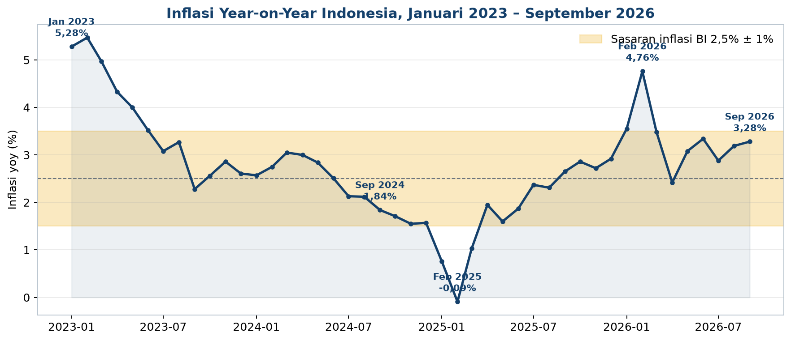
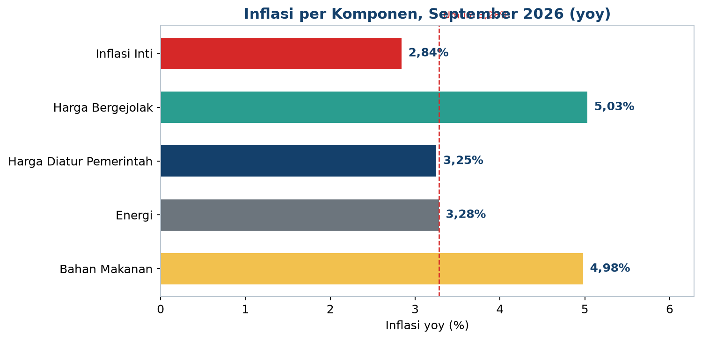
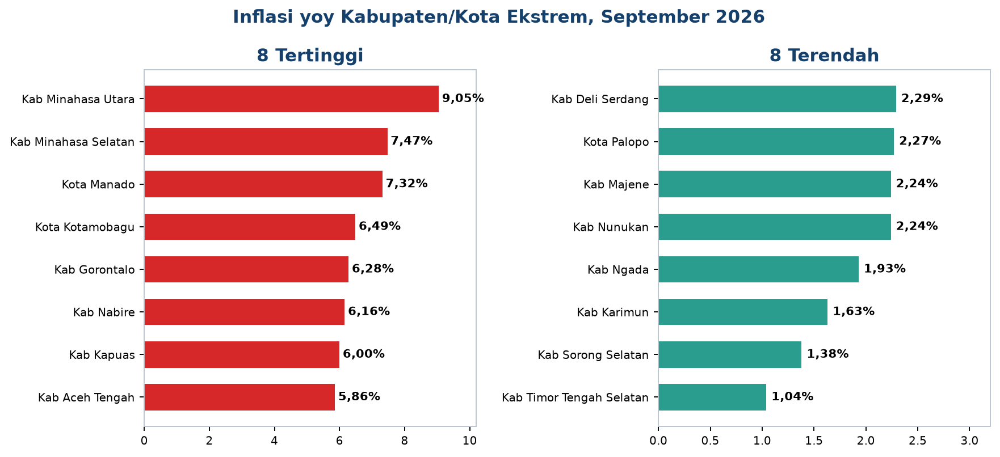
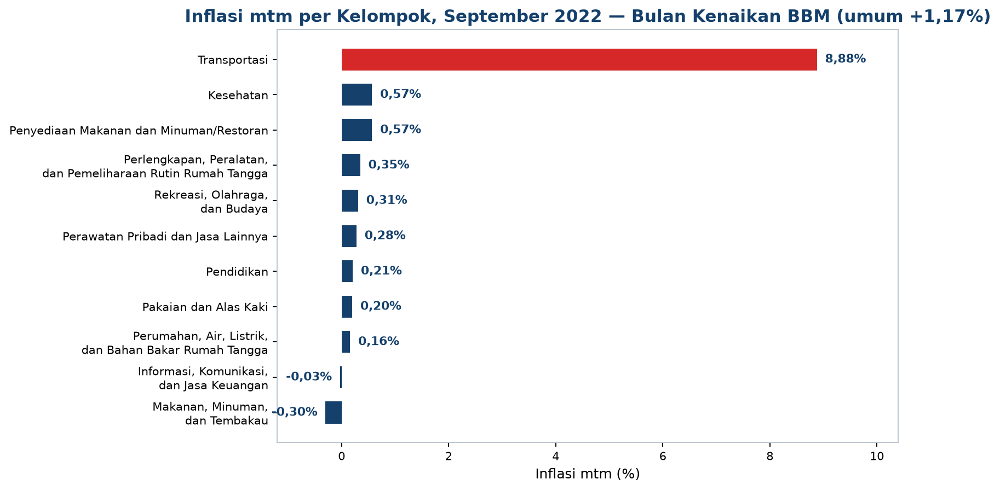
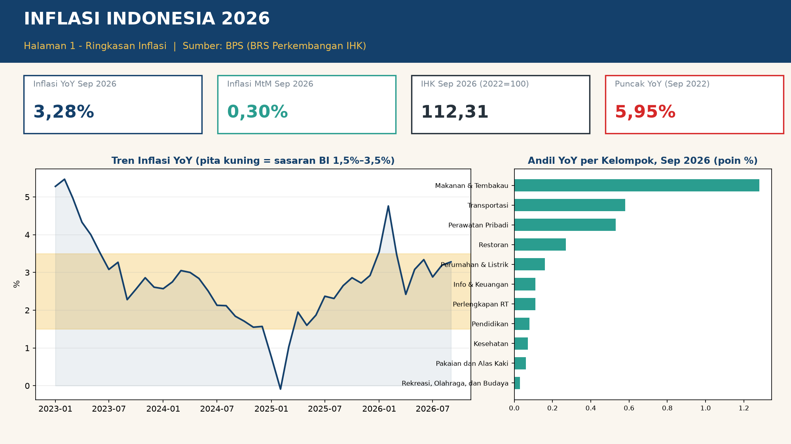

# Inflasi Indonesia 2026

Analisis inflasi Indonesia dari statistik resmi **Badan Pusat Statistik (BPS)**: perjalanan Indeks Harga Konsumen (IHK) dari Januari 2019 sampai September 2026, dirinci per komponen, per kelompok pengeluaran, dan per wilayah (38 provinsi dan 150 kabupaten/kota). Proyek data analyst murni: kompilasi data resmi, pembersihan dan verifikasi, analisis, visualisasi, dashboard Power BI, dan storytelling. Tanpa machine learning.

**Posisi terbaru (September 2026): inflasi year-on-year 3,28%, month-to-month +0,30%, IHK 112,31 (basis 2022=100).**

## Temuan Utama

- **Puncak era ini adalah September 2022: 5,95% yoy**, bulan yang sama dengan kenaikan harga BBM bersubsidi (Transportasi melonjak 8,88% mtm). Inflasi tahunan 2022 ditutup 5,51%, lalu disinflasi menjadi 2,61% (2023) dan 1,57% (2024).
- **19 dari 24 bulan terakhir berada di dalam sasaran Bank Indonesia** (2,5% ± 1%). Tiga bulan di bawah sasaran (Januari sampai Maret 2025) dan dua bulan di atasnya (Januari sampai Februari 2026) sama-sama disebabkan efek diskon tarif listrik dan basis rendahnya.
- **11 bulan deflasi teramati**, termasuk tiga bulan berurutan pada era COVID (Juli sampai September 2020). Deflasi terdalam adalah Februari 2025 (minus 0,48%) akibat diskon tarif listrik.
- **Pangan adalah penggerak berulang**: komponen harga bergejolak 5,03% yoy pada September 2026, dan kelompok Makanan, Minuman, dan Tembakau menjadi penyumbang andil terbesar pada Desember 2023 (1,60 poin), Desember 2025 (1,33), dan September 2026 (1,28). Andil total terbesar tetap datang dari inflasi inti (1,82 poin) yang lengket.
- **Cabai kembali muncul**: dua dari lima penyumbang andil mtm terbesar September 2026 adalah cabai rawit (0,08) dan cabai merah (0,06), pola yang sama dengan temuan pada proyek Harga Cabai dan Harga Pangan.
- **Disparitas daerah lebar**: inflasi yoy kabupaten/kota September 2026 membentang dari 9,05% (Kab. Minahasa Utara) sampai 1,04% (Kab. Timor Tengah Selatan), rentang 8,01 poin. Sebanyak 92 dari 150 kab/kota berada di atas angka nasional; provinsi tertinggi Sulawesi Utara (7,59%), terendah Sumatera Selatan (2,55%).
- **Kemusiman nyata**: rata-rata inflasi mtm tertinggi jatuh pada Maret dan Desember (0,50%), terendah pada Agustus (0,02%).

## Visualisasi Utama

## Dashboard Power BI

Kit siap rakit ada di folder `powerbi/`: model bintang dengan lima tabel fakta pada grain terpisah (bulanan, kelompok, komponen, kota, provinsi) dan enam dimensi, 12 measure DAX bernama polos lengkap dengan tabel verifikasi, panduan rakit langkah demi langkah, dan rancangan empat halaman. Paket PBIP terstruktur ada di folder `pbip/` (lolos validasi struktural penuh).

## Data

| Berkas | Isi |
|---|---|
| `data/inflasi_nasional_bulanan.csv` | 93 bulan (Jan 2019 sampai Sep 2026): IHK, mtm, ytd, yoy. Yoy kontinu Jan 2023 sampai Sep 2026 (45 bulan); titik 2019 sampai 2022 hanya yang terverifikasi |
| `data/inflasi_komponen.csv` | Titik komponen (inti, bergejolak, diatur pemerintah, energi, bahan makanan) dari Tabel 9 BRS dan rilis terkait |
| `data/inflasi_kelompok.csv` | 11 kelompok pengeluaran: Tabel 1 lengkap untuk Nov 2025, Feb 2026, Sep 2026, plus titik Sep 2022, Des 2023, Des 2025, Mar sampai Apr 2026 |
| `data/inflasi_provinsi_2026_09.csv` | 38 provinsi, September 2026 (IHK, yoy, mtm) |
| `data/inflasi_kota_2026_09.csv` | 150 kabupaten/kota, September 2026 (IHK, yoy, mtm) |
| `data/SOURCES.md` | Penelusuran lengkap: nomor dan tanggal BRS, metode kompilasi, verifikasi jangkar, dan keterbatasan data |

Basis IHK berganti dari 2018=100 (sampai Des 2023) menjadi 2022=100 (mulai Jan 2024). Laju mtm dan yoy tetap dapat dibandingkan lintas pergantian basis; level IHK tidak disambung. Semua jangkar inflasi tahunan Desember terverifikasi cocok: 2019 2,72%, 2020 1,68%, 2021 1,87%, 2022 5,51%, 2023 2,61%, 2024 1,57%, 2025 2,92%.

## Isi Repo

- `Portofolio-Analisis-Inflasi.pptx` — deck portofolio 10 slide
- `Modul-Analisis-Inflasi.pdf` — modul pembelajaran (landscape, ramah pemula, termasuk bab Power BI)
- `analysis.ipynb` dan `scripts/` — notebook serta skrip kompilasi, analisis, dan pembangunan seluruh deliverable
- `charts/` — 13 grafik analisis berlabel Bahasa Indonesia
- `sql/queries.sql` — 14 kueri analisis dengan hasil harapan
- `powerbi/` — kit Power BI (CSV model bintang, DAX, layout, panduan, pratinjau)
- `pbip/` — paket Power BI Project (PBIP) tervalidasi
- `findings.json` — seluruh angka temuan terstruktur

## Metode Singkat

1. Parse PDF BRS BPS (Nov 2025, Feb 2026, Sep 2026) per tabel dengan skrip khusus, termasuk tabel geografi dua kolom 150 kab/kota.
2. Kompilasi seri historis dari BRS dan publikasi BPS terdahulu; setiap angka dicatat sumbernya.
3. Verifikasi: tujuh jangkar Desember, konsistensi mtm terhadap rantai IHK (12 dari 12 bulan pada 2023), dan cek silang prosa BRS terhadap tabel geografi.
4. Analisis dihitung ulang dari CSV terkompilasi ke `findings.json`, lalu divisualkan dan dirakit menjadi deck, modul, kit Power BI, dan PBIP.

*Disusun oleh BAGHIZ ASSHIDDIQIE ARASYA, Data Analyst. Data: BPS (bps.go.id).*
